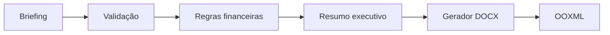

# ARI CONSULTING

## Visão Geral

ARI CONSULTING é uma aplicação demonstrativa e autoral em Python que transforma um briefing comercial estruturado em uma proposta DOCX validada. A versão pública demonstra arquitetura, validação explícita, cálculos monetários, geração documental e testes automatizados.

## Problema

A preparação manual de propostas pode produzir campos ausentes, dados inconsistentes, descontos incorretos e divergências entre os valores informados e o documento final. Também existe o risco de confundir dados fictícios com informações comerciais reais.

## Solução

```text
Briefing
→ Validação
→ Regras de negócio
→ Resumo executivo
→ Geração DOCX
```

Um briefing inválido interrompe o processamento antes do resumo e da geração documental. O sistema nunca completa automaticamente informações comerciais ausentes.

## Modos de funcionamento

### MODO TESTE

- Aceita dados fictícios.
- Permite e-mails com domínio `.example`.
- Identifica a saída como demonstração.
- É o modo atualmente aceito pelo gerador DOCX demonstrativo.

### MODO REAL

- Não inventa ou completa campos.
- Bloqueia campos obrigatórios ausentes.
- Rejeita dados explicitamente fictícios.
- Rejeita e-mails com domínio `.example`.

O núcleo valida briefings em MODO REAL, mas a geração DOCX pública está limitada ao MODO TESTE.

## Arquitetura



- `models.py`: modelos imutáveis de modo, briefing, serviço, resultado comercial e resumo.
- `validation.py`: campos obrigatórios, e-mail, dados fictícios, desconto, quantidades e preços.
- `business.py`: subtotal, desconto, total e arredondamento monetário.
- `summary.py`: resumo executivo construído com dados validados.
- `pipeline.py`: coordenação entre validação, regras financeiras e resumo.
- `docx_generator.py`: geração do pacote DOCX demonstrativo em OOXML.
- `__init__.py`: API pública principal do núcleo.

## Regras de negócio

```text
valor do item = quantidade × valor unitário
subtotal = soma dos valores dos itens
valor do desconto = subtotal × percentual de desconto ÷ 100
total = subtotal − valor do desconto
```

Os cálculos usam `Decimal`, duas casas decimais e `ROUND_HALF_UP`. O desconto deve estar entre 0 e 100, as quantidades devem ser positivas e os preços não podem ser negativos.

## Geração DOCX

O documento é produzido do zero, diretamente em OOXML compactado em ZIP, usando somente a biblioteca padrão do Python. Nenhum template de terceiro é utilizado.

A saída contém identificação de demonstração, cliente fictício, e-mail `.example`, resumo executivo, itens, valores, desconto, total calculado e aviso de uso exclusivamente demonstrativo. O pipeline completo é executado antes da escrita física.

## Tecnologias

- Python
- Biblioteca padrão
- OOXML, ZIP e XML
- `unittest`
- `Decimal`
- `tempfile`

## Testes

- 11 testes unitários
- 1 teste de integração
- 12 testes no total
- 12 aprovados
- 0 falhas
- 0 erros

Os testes unitários verificam isoladamente validações, modos, e-mails `.example`, ausência de campos, cálculos financeiros e resumo executivo.

O teste de integração percorre dados fictícios, validação, regras financeiras, resumo e geração física de um DOCX temporário. Ele verifica o arquivo, a estrutura ZIP e OOXML, os valores e a remoção do artefato ao final.

## Como executar os testes

Na raiz do projeto:

```powershell
python -m unittest discover -s tests -v
```

## Segurança e privacidade

- Materiais locais não fazem parte da versão pública.
- Dados de demonstração são fictícios.
- O domínio reservado `.example` é usado nos testes.
- Nenhum segredo, token, credencial ou variável de ambiente é necessário.
- Nenhuma chamada externa é necessária.
- O MODO REAL não inventa dados comerciais.

## Estrutura pública do projeto

```text
ARI-CONSULTING/
├── .gitignore
├── README.md
├── src/
│   └── ari_consulting/
│       ├── __init__.py
│       ├── business.py
│       ├── docx_generator.py
│       ├── models.py
│       ├── pipeline.py
│       ├── summary.py
│       └── validation.py
└── tests/
    ├── test_core.py
    └── test_docx_integration.py
```

## Limitações

- Não há interface gráfica, aplicação web, API HTTP ou CLI.
- Não há banco de dados, autenticação, persistência ou integração externa.
- A entrada é fornecida programaticamente pelos modelos Python.
- O gerador DOCX é mínimo e exclusivo para demonstrações em MODO TESTE.
- O núcleo valida o MODO REAL, mas não gera documentos reais.
- A validação de e-mail é básica.
- O OOXML possui estrutura e estilos mínimos, sem identidade visual corporativa.

## Engenharia aplicada

O projeto separa modelos, validação, regras financeiras, resumo, orquestração e saída documental. `Decimal` evita imprecisões de ponto flutuante, e o OOXML é gerado de modo determinístico sem templates.

A suíte combina testes unitários rápidos com um teste de integração que cria, inspeciona e remove um arquivo real em diretório temporário. A separação entre MODO TESTE e MODO REAL isola dados demonstrativos e impede o preenchimento automático de informações obrigatórias.

## Evidências visuais

<!-- Evidência futura: diagrama e fluxo -->

<!-- Evidência futura: execução em MODO TESTE -->

<!-- Evidência futura: página de DOCX demonstrativo autoral -->

<!-- Evidência futura: resultado da suíte de testes -->
